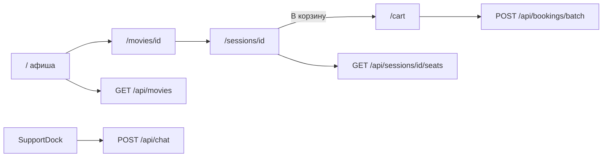

# Воссоздание сайта bileet (бронирование кино)

## Контекст

- Рабочая папка `[C:\Users\user\Desktop\Курс по ии\дз\кино сайт](C:\Users\user\Desktop\Курс по ии\дз\кино сайт)` **пустая** — локальной копии кода нет; на Origin у пользователя репозиториев тоже нет.
- Восстановление опирается на кэш переписки [Кинобилеты и чат-бот](bc-c6d01bf9-5ce3-4d60-815b-f6c2419633f5) и финальный чеклист перед «оплатил»:
  - бренд **bileet**, `http://127.0.0.1:43123`
  - **12 фильмов**, крупные постеры (URL TMDB в моках, без внешнего API-ключа)
  - шрифт **Times New Roman**
  - **светлая/тёмная тема** (`next-themes`, переключатель в шапке)
  - шапка: только логотип **bileet** + тема (без «Афиша», «Корзина», без «кино · Ташкент»)
  - **SupportDock**: справа снизу «Помощник», слева от него «Корзина» (~0.5 cm), панели открываются **над** кнопками
  - схема зала в духе afisha.uz: экран сверху, проход по центру, зоны **Standard / Comfort / VIP**, легенда, до **8** мест
  - корзина на **разные фильмы/дни**, persist в **localStorage**, статус «В корзине» на схеме
  - оплата: имя + email → номер заказа; `**POST /api/bookings/batch**` для всей корзины
  - чат: **6 FAQ** + keyword-агент через `**POST /api/chat`** (без внешнего LLM)
  - правило Cursor `**.cursor/rules/mock-data.mdc**` (alwaysApply)
  - `**[.cursor/environment.json](.cursor/environment.json)**`: `npm install`, dev на порту **43123**

## Стек


| Слой                 | Выбор                                                            |
| -------------------- | ---------------------------------------------------------------- |
| Framework            | **Next.js** (App Router) + **TypeScript** (как вы выбрали)       |
| Стили                | Tailwind + CSS-переменные под light/dark                         |
| Данные               | In-memory store на сервере + статические моки в `src/data/mock/` |
| Клиентское состояние | React context + `localStorage` для корзины                       |


## Архитектура потока




## Структура проекта (ключевые файлы)

```
кино сайт/
  .cursor/
    rules/mock-data.mdc
    environment.json
  src/
    data/mock/
      movies.ts          # 12 фильмов, posterPath (image.tmdb.org), сеансы по дням/кинотеатрам
      halls.ts           # шаблон рядов, зоны, цены (UZS)
      chat-faq.ts        # 6 тем + keyword-правила
    lib/
      store.ts           # in-memory: занятые места, брони, генерация orderId
      cart-storage.ts    # read/write localStorage без гонки с гидратацией
    context/
      cart-context.tsx   # add/remove/clear + синхронная запись в storage
    components/
      site-header.tsx    # bileet + ThemeToggle
      movie-grid.tsx
      session-picker.tsx
      hall-map.tsx       # схема + легенда + лимит 8 мест
      seat-sidebar.tsx   # итог, «В корзину»
      support-dock.tsx   # корзина + чат
      chat-panel.tsx
      theme-provider.tsx
    app/
      layout.tsx         # Times New Roman, ThemeProvider, SupportDock
      page.tsx           # афиша
      movies/[id]/page.tsx
      sessions/[id]/page.tsx
      cart/page.tsx
      api/movies/route.ts
      api/sessions/[id]/seats/route.ts
      api/bookings/route.ts
      api/bookings/batch/route.ts
      api/chat/route.ts
  package.json           # dev: next dev -p 43123
  README.md
```

## API (поведение как в оригинале)

- `**GET /api/movies**` — список фильмов с краткими метаданными и вложенными сеансами (или id сеансов для навигации).
- `**GET /api/sessions/[id]/seats**` — сетка мест + `occupied` / `zone` / `price`; учитывает уже забронированные места из `store`.
- `**POST /api/bookings**` — одиночная демо-бронь (имя, email, sessionId, seatIds) для совместимости.
- `**POST /api/bookings/batch**` — массив позиций корзины → одна оплата, несколько order lines, пометка мест занятыми, очистка корзины на клиенте после успеха.
- `**POST /api/chat**` — сопоставление текста с FAQ (возврат, оплата, время прихода, детский тариф, лимит мест, письмо с билетом) + быстрые подсказки.

Серверный store — **Map в памяти процесса** (после перезапуска dev-сервера брони сбрасываются — как в описании «брони в памяти сервера»).

## UI / UX (финальные правки из переписки)

- Главная: сетка **крупных постеров**, 12 карточек, переход «Выбрать сеанс».
- Страница фильма: описание + выбор **кинотеатра и времени** (несколько дней).
- Страница сеанса: **HallMap** + боковая панель; кнопка **«В корзину»** (не мгновенная оплата с места); места уже в корзине — disabled/бейдж «В корзине».
- `**/cart**`: группировка по сеансу (фильм, дата, места, сумма), удаление строк, **«Оформить все билеты»** → форма имя/email → success с номером заказа.
- **SupportDock**: плавающие кнопки на всех страницах; счётчик позиций на «Корзине».

## Правила и запуск

- **mock-data.mdc**: при отсутствии бэкенда/БД всегда использовать `src/data/mock/`; API только читает/обновляет in-memory поверх моков.
- **environment.json** для Cloud Agent: install + `npm run dev -- -p 43123`.
- **README**: сценарий проверки (фильм A + B → корзина → batch → обновление страницы → места «В корзине»), команды `npm install`, `npm run dev -- -p 43123`, `npm run build`.

## Проверка после реализации

1. `npm run build` без ошибок; главная и `/api/movies` отвечают 200.
2. Ручной сценарий из переписки: два фильма → корзина → оба сеанса видны → batch-оплата → order id.
3. Чат: 6 FAQ-кнопок и свободный ввод с keyword-ответами.
4. Переключение темы без «мигания» (class на `html` через `next-themes` + при необходимости inline script в layout).
5. `next.config` — `images.remotePatterns` для `image.tmdb.org`.

## Что сознательно не делаем

- Реальная платёжка, email-рассылка, TMDB API live-fetch, PostgreSQL — только моки и демо-оплата, как в оригинале.

